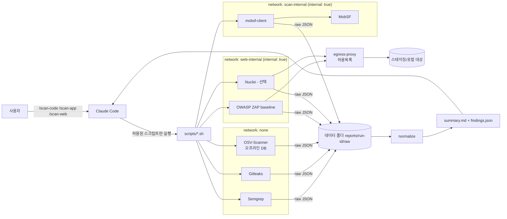

# 아키텍처

상위: [[보안 툴킷]] · 관련: [[네트워크 격리]], [[리포트 포맷]]

## 전체 구조



- Claude는 **`summary.md` / `findings.json`만** 읽는 것을 기본으로 한다. raw 리포트는 필요할 때만 참조.
- MobSF는 **호스트 포트를 열지 않는다**. 같은 internal 네트워크의 `mobsf-client` 컨테이너가 REST API를 호출한다. → [[MobSF]]
- 웹 점검 컨테이너는 인터넷에 직접 나가지 못하고, 허용목록 프록시만 통과한다. → [[네트워크 격리]]

## 디렉터리 레이아웃 (구현 목표)

보안 툴킷은 `dev-workflow-kit` 레포의 **`security` 플러그인**으로 배포한다. → [[ADR-006 플러그인 마켓플레이스 구조]], [[레포 통합 계획]]

### 레포 (플러그인 소스)
```text
dev-workflow-kit/
├── .claude-plugin/marketplace.json
├── plugins/
│   ├── workflow/                  # 기존 커맨드 (commit, create-pr, pr-review, apply-review, pipeline)
│   └── security/
│       ├── .claude-plugin/plugin.json
│       ├── skills/
│       │   ├── scan-code/SKILL.md
│       │   ├── scan-app/SKILL.md
│       │   └── scan-web/SKILL.md
│       ├── docker/
│       │   ├── compose.yml        # mobsf, mobsf-client, zap, nuclei, egress-proxy
│       │   ├── images.lock        # 이미지 digest 고정 목록
│       │   └── proxy/             # 허용목록 프록시 설정 템플릿
│       ├── rules.lock             # Semgrep 규칙·Nuclei 템플릿 고정 커밋
│       ├── profiles/              # 스택별 프로파일 (ios, android, flutter, react-native, web, server)
│       ├── rules/custom/<stack>/  # 스택별 커스텀 Semgrep 규칙
│       ├── tests/fixtures/<stack>/ # 스택별 의도적 취약 샘플 (회귀 기준선)
│       ├── scripts/
│       │   ├── scan-code.sh
│       │   ├── scan-app.sh
│       │   ├── scan-web.sh
│       │   ├── update.sh          # 유일하게 외부 통신하는 스크립트
│       │   ├── normalize.py       # raw → findings.json/summary.md
│       │   ├── cleanup.sh
│       │   └── lib/                # common.sh(경로 검증, run-id, 허용목록), detect.sh(프로파일 감지)
│       └── examples/
│           ├── settings.permissions.json   # ~/.claude/settings.json에 추가할 권한 예시
│           ├── targets.allowlist.example
│           └── toolkit.env.example
├── docs/                          # Obsidian vault (이 문서들은 docs/security/)
└── examples/mcp.json.example
```

### 사용자 데이터 (플러그인 폴더 밖)
플러그인 폴더는 업데이트 시 교체될 수 있으므로 데이터는 밖에 둔다.
```text
~/.config/dev-workflow-kit/security/
├── .env                       # MobSF API 키 (권한 600)
└── targets.allowlist          # 웹 점검 허용 대상 (사용자가 직접 편집)

~/.local/share/dev-workflow-kit/security/
├── data/
│   ├── osv/                   # OSV 오프라인 DB
│   ├── semgrep-rules/         # rules.lock 기준으로 받은 규칙
│   └── nuclei-templates/      # (선택)
└── reports/<run-id>/          # 스캔 결과
```

## 경로 표기
모든 노트에서 아래 별칭을 쓴다.

| 별칭 | 실제 경로 | 내용 |
|---|---|---|
| `$PLUGIN` | `${CLAUDE_PLUGIN_ROOT}` (설치된 `security` 플러그인) | 스크립트, compose, lock 파일 — 읽기 전용 취급 |
| `$DATA` | `~/.local/share/dev-workflow-kit/security` | 리포트, OSV DB, 받은 규칙·템플릿 |
| `$CONF` | `~/.config/dev-workflow-kit/security` | `.env`, `targets.allowlist`, 커스텀 규칙 |

## 실행 흐름 공통
1. 스킬이 `${CLAUDE_PLUGIN_ROOT}/scripts/scan-*.sh <target>` 호출
2. 스크립트가 입력 검증 (경로 존재, 허용목록, 파일 형식)
3. `~/.local/share/dev-workflow-kit/security/reports/<YYYYMMDD-HHMMSS>-<kind>/raw/`에 도구별 결과 저장
4. `normalize.py`가 [[리포트 포맷]]으로 변환 + 마스킹
5. Claude가 `summary.md` 읽고 우선순위별 분석 → 수정 제안

워크플로 상세: [[scan-code]], [[scan-app]], [[scan-web]]
