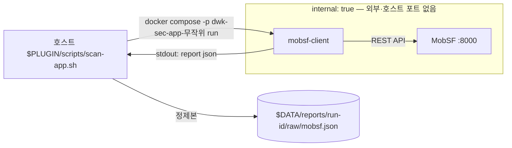

# MobSF (Mobile Security Framework)

상위: [[보안 툴킷]] · 워크플로: [[scan-app]]

## 역할
APK / AAB / IPA 바이너리 **정적분석**. 매니페스트·ATS 설정, network_security_config, 서명 인증서, 디컴파일 코드 패턴(약한 암호, 로그, 하드코딩), 바이너리 보호 기법(PIE·스택 보호·ARC), 위험 권한, 하드코딩 시크릿 후보.
동적분석은 범위 밖 → [[미결정 사항]]

고정 버전: `opensecurity/mobile-security-framework-mobsf` **v4.6.4** (`images.lock`, 2026-11-01 공개, linux/amd64·arm64, 약 2.5GB)

## 배치

- `docker/compose.yml`. 실행마다 무작위 프로젝트 이름(`dwk-sec-app-<12자 16진수>`)으로 띄우고 끝나면 `down -v`로 컨테이너·네트워크·볼륨을 모두 지운다. 정상 종료·INT·TERM 은 `trap`이 정리하고, SIGKILL 처럼 trap 이 돌지 못한 경우는 **다음 실행이** 3시간 넘게 지난 스택을 지운다. 동시에 두 번 실행해도 섞이지 않는다.
- `mobsf`: digest 고정 이미지, **`ports` 미지정** → 호스트에서도 접근 불가. `cap_drop: ALL`·`no-new-privileges`·`pids_limit`·메모리 6GB 상한(압축 폭탄이 VM 전체를 멈추지 않게, 넘으면 `OOMKilled`를 summary 에 알림). 볼륨 크기는 제한하지 못하므로 압축 해제 총량 4GB 상한을 업로드 전에 건다. 업로드·디컴파일 결과·DB 는 실행마다 새로 만드는 볼륨(`mobsf-home`)에만 남는다. 루트 파일시스템은 읽기 전용으로 두지 못한다 — 기동 때 `makemigrations`가 코드 폴더에 파일을 만든다.
- `mobsf-client`: **MobSF 이미지를 그대로 쓴다** (설계 초안의 "curl/python 최소 이미지" 대신 — 이미지를 하나 더 들이지 않고, AAB 변환에 필요한 java·bundletool·aapt2 가 이미 있다). 읽기 전용 루트·`cap_drop: ALL`·호스트 사용자로 실행, 산출물과 클라이언트 스크립트(`scripts/lib/mobsf_client.py`)만 읽기 전용으로 마운트한다. 리포트는 **stdout 으로만** 내보내고 호스트가 umask 077 로 쓴다 — 호스트로 쓰는 마운트가 없다.
- 네트워크 `scan-internal`은 `internal: true` → 인터넷 차단. 실측(2026-11-15): 컨테이너에서 `1.1.1.1:80`·`8.8.8.8:53` 연결과 `example.com` DNS 조회가 즉시 실패하고, 같은 네트워크의 `mobsf` 이름만 풀린다. `PortBindings`는 `{}`.
- **업로드 전 격리 확인**: Moby 26.0.0·25.0.5·23.0.11 미만은 internal 네트워크 컨테이너의 외부 DNS 질의를 dockerd 가 호스트에서 대신 보낸다(CVE-2024-29018) — 끌 수 없는 스토어·Firebase 조회가 DNS 로 새는 경로다. 그래서 실행마다 MobSF 컨테이너에서 `example.com`·`play.google.com` 이름 풀이와 `1.1.1.1:443` 연결을 시도하고, 프록시 환경변수(`~/.docker/config.json` 의 `proxies`가 넣는 `HTTP(S)_PROXY` 등 — MobSF 의 `requests`가 따름)도 본다. 하나라도 걸리면 **앱을 올리지 않고** 실패로 끝낸다. 정확히 `isolated`가 출력될 때만 통과한다(확인 자체가 실패해도 올리지 않음).

## REST API 흐름 (`mobsf_client.py`, 표준 라이브러리만)
1. 준비 대기: `report_json`에 없는 hash 를 보내 500 미만 응답(보통 404)이 오면 준비됨 (`compose up --wait`의 헬스체크는 웹 로그인 페이지만 본다). 401 이면 키 오류로 중단
2. `POST /api/v1/upload` (multipart, 파일 이름 `app.<확장자>`) → `hash`(32자 16진수만 받음)
3. `POST /api/v1/scan` (`hash`) — 동기, 응답 상한 256MB. 업로드는 파일을 조금씩 읽어 보낸다(메모리에 통째로 올리지 않음)
4. `POST /api/v1/report_json` (`hash`) → stdout. `app_type`이 없으면(분석 오류) 실패
5. `POST /api/v1/delete_scan` — **항상**(실패해도) 호출해 MobSF 내부 저장본을 지운다. 볼륨도 지우므로 이중 정리

인증: 헤더 `X-Mobsf-Api-Key`. MobSF 는 환경변수 `MOBSF_API_KEY`를 읽는다. **키는 실행마다 새로 만든다** (64자 16진수) — MobSF 가 기동 로그에 API 키를 그대로 찍기 때문에 고정 키(설계 초안의 `.env`)를 두지 않는다. 같은 이유로 `MOBSF_SECRET_KEY`·`DJANGO_SUPERUSER_PASSWORD`(기본 `mobsf/mobsf` 대신)도 실행마다 만든다. 툴킷이 남기는 로그(`raw/*.log`)에서는 이 값들을 `[MASKED]`로 바꾼다. → [[시크릿 처리]]

## AAB
MobSF v4.6.4 는 AAB 를 bundletool 로 universal APK 로 바꾸는데, bundletool 에 들어 있는 aapt2 가 **x86-64 바이너리**라 arm64 이미지(Apple Silicon)에서 변환이 항상 실패한다(`Invalid AAB File`, 실측). 툴킷은 mobsf-client 의 tmpfs 안에서 이미지의 arm64 `aapt2`를 지정해(`build-apks --mode=universal --aapt2=/usr/bin/aapt2`) 먼저 바꾼 뒤 APK 로 올린다. 이 universal APK 는 서명되지 않으므로 AAB 점검에서는 **서명 결과를 빼고** 경고로 알린다.

## 외부 통신 (v4.6.4 코드·실측 확인)
| 기능 | 내용 | 끄는 방법 | 이 설계 |
|---|---|---|---|
| 업데이트 확인 | 기동 시 GitHub 조회 | 없음 (인터넷 확인 실패 시 건너뜀) | 네트워크 차단 |
| 악성 도메인 확인 | maltrail DB 다운로드·조회 | `MOBSF_DOMAIN_MALWARE_SCAN=0` | 설정으로 끄기 + 네트워크 차단 |
| VirusTotal | 해시·파일 업로드 | `MOBSF_VT_ENABLED=0`(기본) | 설정으로 끄기 + 네트워크 차단 |
| AppMonsta | 스토어 정보 대체 조회 | `MOBSF_APPMONSTA_API` 비움(기본) | 비움 |
| Play Store 조회 | 패키지명으로 Play 페이지 요청 | **없음** | 네트워크 차단만 |
| App Store 조회 | 번들 ID 로 iTunes lookup | **없음** | 네트워크 차단만 |
| Firebase 확인 | 앱의 `*.firebaseio.com/.json`·Remote Config 요청 (앱 데이터 기반) | **없음** | 네트워크 차단만 |
| 트래커 DB | exodus-privacy 갱신 | 없음 (인터넷 확인 실패 시 건너뜀) | 네트워크 차단 |
| jadx 설치 | `~/.MobSF/tools/jadx` 없으면 GitHub 에서 받음 | 이미지에 포함 (볼륨이 복사) | 네트워크 차단 |

> [!warning] 설정으로 끌 수 없는 조회
> 스토어·Firebase 조회는 설정 항목이 없다. 패키지명·번들 ID·앱이 가진 Firebase 주소가 외부로 나갈 수 있는 경로이므로 **`internal: true` 네트워크가 유일한 차단 수단**이다. 차단 상태에서는 DNS 조회가 즉시 실패해 분석이 느려지지 않는다 (실측: 8KB APK 2초 안팎). 웹 UI 예외 모드(아래)를 쓰지 않는 이유이기도 하다.

## 결과 해석 (`scripts/lib/mobsf_report.py`)
| MobSF 섹션 | rule_id | 위치 |
|---|---|---|
| `manifest_analysis.manifest_findings` | `mobsf.manifest.<rule>` | `AndroidManifest.xml` |
| `network_security.network_findings` | `mobsf.network.cleartext`·`user-certs`·`pinning`(도메인 설정은 `domain-` 접두) | `res/xml (networkSecurityConfig)`, scope 는 package |
| `certificate_analysis.certificate_findings` | `mobsf.cert.<제목>` | — (AAB 는 제외) |
| `code_analysis.findings` | `mobsf.code.<규칙>` | 디컴파일 경로:첫 줄 (규칙당 20개 파일) |
| `binary_analysis` (Android `.so` / iOS) | `mobsf.so.<보호기법>` / `mobsf.binary.<제목>` | so 경로 |
| `macho_analysis`·`dylib_analysis`·`framework_analysis` | `mobsf.macho.<보호기법>`·`mobsf.dylib.*` | 바이너리 이름 |
| `ats_analysis.ats_findings` | `mobsf.ats.<제목>` | `Info.plist` |
| `file_analysis` (인증서·키·DB 파일) | `mobsf.file.<제목>` | 파일 경로 |
| `permissions` (status `dangerous`) | `mobsf.permission.<이름>` (info) | 권한 이름 |
| `secrets` | `mobsf.secret.hardcoded` (high, 분류 secret) | **키 이름만** (package) |

- Severity: `high`→high, `warning`→medium, `info`→info, `secure`·`good`·`suppressed`·`hotspot`·빈 값→제외, 그 밖의 알 수 없는 값→medium. 보호 기법(macho·so·dylib)은 켜진 정상 상태도 info 로 오므로 high·warning 만 남긴다. `macho.encrypted`(직접 빌드한 IPA 는 암호화되지 않는 게 정상)는 info 로 내린다.
- iOS 리포트의 `app_type`은 언어 이름(`Objective C`·`Swift`)이다 — 플랫폼은 섹션(`manifest_analysis`/`ats_analysis`)으로 판정한다.
- 디버그 키(`CN=Android Debug`) 서명이면 summary 경고와 `debuggable` 결과의 조치에 "릴리스 빌드로 다시 점검"을 붙인다.
- 섹션당 300건, 코드 규칙당 20개 파일까지 넣고 넘으면 경고한다. 섹션 하나의 구조가 예상과 달라도(MobSF 버전 차이·조작된 앱) 그 섹션만 빠지고 경고로 남는다.
- 위치(file·package)는 앱이 정하는 값이라 식별자 문자 밖은 퍼센트 인코딩한다(id 는 인코딩 전 값으로) → [[scan-app#단계 (`scripts/scan-app.sh`)]]. 섹션 타입이 예상과 다르면 그 섹션은 빠지고 경고가 남는다. `secrets`의 키 이름은 이름처럼 보일 때만 남긴다(숫자 비율·연속 숫자·구분자 없는 긴 이름은 값으로 보고 버림).
- 소스 점검 대응: `debuggable`·`allowBackup`·`usesCleartextTraffic`·nsc 평문·사용자 CA·ATS 결과의 `references`에 `scan-code: <규칙>`을 붙인다 → [[scan-app#소스 점검과 함께 볼 때]]

## raw 보관본
MobSF 리포트에는 앱에서 뽑은 **시크릿 원문**(`secrets`)과 문자열 덤프(`strings`)가 그대로 들어 있다(실측). 원본(`raw/mobsf-full.json`)은 정규화 직후 지우고(오류·중단 시 trap, SIGKILL 이면 다음 실행이 3시간 뒤 정리), `raw/mobsf.json`에는 `strings`·`secrets`·`logs`·`files`·스토어 정보·`info_plist` 등을 **개수만** 남긴 정제본을 둔다. 나머지 문자열·사전 키도 시크릿 패턴 재마스킹(키=값·고엔트로피 포함)을 거친다. 경로가 확실한 자리(`files` 사전의 키, `file_path`·`path`·`name` 값)만 긴 경로가 가려지지 않게 식별자용 마스킹을 쓴다 — 값의 모양으로 고르면 URL 쿼리 토큰·`/`가 든 base64 시크릿이 드러난다(2차 리뷰 NW1). 목록은 2000개까지만 남는다. → [[시크릿 처리]]

## 보안 설정
- 기본 계정 `mobsf/mobsf` 사용 안 함 — 관리자 비밀번호를 실행마다 무작위로 바꾸고, 호스트 포트가 없어 UI 자체를 쓰지 않는다 (Q6 결정)
- 과거 CVE 이력이 있으므로 **절대 외부 노출 금지**, 버전은 [[업데이트 절차]]로 관리
- 분석 중 앱 문자열(앱 이름·URL·리소스)은 신뢰하지 않는 데이터 → [[위협 모델#T5 프롬프트 인젝션]]

## 웹 UI가 필요할 때 (예외 모드) — 구현하지 않음
Q6 결정(2026-11-15): 웹 UI 는 쓰지 않는다. 스토어·Firebase 조회를 설정으로 끌 수 없어 bridge 네트워크의 UI 모드는 외부 통신을 막을 수 없기 때문이다. 필요해지면 `internal` 네트워크 + 호스트 쪽 리버스 프록시(127.0.0.1 바인딩) 구성을 따로 설계한다.

## Severity 매핑
MobSF `high/warning/info/secure` → `high/medium/info/(제외)`

> [!check] 검증 결과 (2026-11-15, v4.6.4 실측)
> - 외부 조회 끄기: `MOBSF_DOMAIN_MALWARE_SCAN=0`·`MOBSF_VT_ENABLED=0`·`MOBSF_APPMONSTA_API=''`. 스토어·Firebase 는 끄는 설정 없음 (위 표)
> - API 키: 환경변수 `MOBSF_API_KEY`(또는 `MOBSF_API_KEY_FILE`), 헤더 `X-Mobsf-Api-Key`(또는 `Authorization`)
> - 완전 오프라인 기동: internal 네트워크에서 약 30초 만에 healthy, 시작 시 다운로드 없음 (jadx 는 이미지에 포함)
> - AAB: 직접 분석은 arm64 에서 실패 → 툴킷이 미리 변환 (위). IPA: 직접 빌드한 IPA 는 Info.plist(ATS·권한)·Mach-O 보호 기법·바이너리 API·문자열까지 분석. FairPlay 암호화된 IPA 는 바이너리 결과가 비므로 `SC_Info/`가 있으면 경고한다
