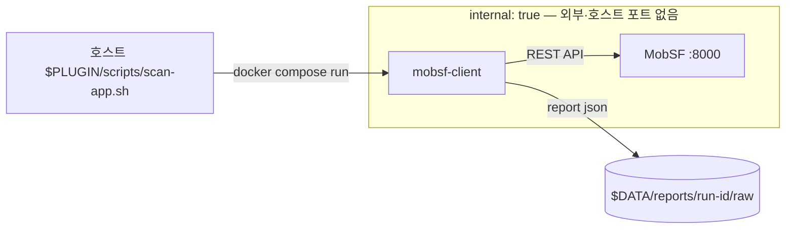

# MobSF (Mobile Security Framework)

상위: [[보안 툴킷]] · 워크플로: [[scan-app]]

## 역할
APK / AAB / XAPK / IPA 바이너리 **정적분석**. 권한, 매니페스트 설정, 평문 통신, 하드코딩 키, 취약 암호화, 난독화 여부 등.
동적분석은 범위 밖 → [[미결정 사항]]

## 배치

- `mobsf`: 공식 이미지(digest 고정), **`ports` 미지정** → 호스트에서도 접근 불가
- `mobsf-client`: curl/python만 있는 최소 이미지. 업로드 → 스캔 → JSON 리포트 다운로드
- 네트워크 `scan-internal`은 `internal: true` → 인터넷 차단
- 분석 끝나면 `docker compose stop mobsf`

## REST API 흐름
1. `POST /api/v1/upload` (파일) → `hash`
2. `POST /api/v1/scan` (`hash`)
3. `POST /api/v1/report_json` (`hash`) → `raw/mobsf.json`
4. (선택) `POST /api/v1/delete_scan` — 분석 후 MobSF 내부 저장본 삭제

인증: API 키 헤더. 키는 `.env`(gitignore)로 주입. → [[시크릿 처리]]

## 외부 통신 (기본값에서 발생 가능)
| 기능 | 내용 | 이 설계 |
|---|---|---|
| 도메인 악성 여부 조회 | 앱에서 추출한 도메인을 외부 서비스로 조회 | 설정으로 끄기 + 네트워크 차단 |
| 스토어 정보 조회 | 패키지명/번들ID로 Play·App Store 조회 | 설정으로 끄기 + 네트워크 차단 |
| VirusTotal | 기본 꺼짐, 키 필요 | 사용 안 함 |
| 업데이트 확인 | — | 네트워크 차단 |

네트워크가 차단되어 있으므로 조회 실패 시 타임아웃으로 분석이 느려질 수 있다 → 설정으로도 끈다.

## 보안 설정
- 기본 계정 `mobsf/mobsf` 사용 안 함 (호스트 포트가 없으므로 UI 미사용이 기본)
- 컨테이너 `read_only` 가능 여부 검토, 업로드 저장 볼륨은 run마다 정리
- 과거 CVE 이력이 있으므로 **절대 외부 노출 금지**, 버전은 [[업데이트 절차]]로 관리

## 웹 UI가 필요할 때 (예외 모드)
`compose --profile ui`로 `127.0.0.1:8000`만 바인딩한 별도 서비스 기동. 이 모드는 일반 bridge 네트워크라 외부 통신 가능하므로 **설정상 외부 조회 기능이 꺼져 있어야만** 허용. 사용 후 즉시 종료.

## Severity 매핑
MobSF `high/warning/info/secure` → `high/medium/info/(제외)`

> [!warning] 검증 필요
> - 외부 조회 기능을 끄는 정확한 설정·환경변수 이름 (`mobsf/MobSF/settings.py` 확인)
> - API 키 설정 방식(환경변수 `MOBSF_API_KEY` 등)과 헤더 이름
> - 완전 오프라인에서 Docker 이미지 기동·분석이 정상 동작하는지 (시작 시 다운로드 여부)
> - AAB 직접 지원 여부와 iOS IPA 분석 범위(복호화 안 된 IPA 한계)
