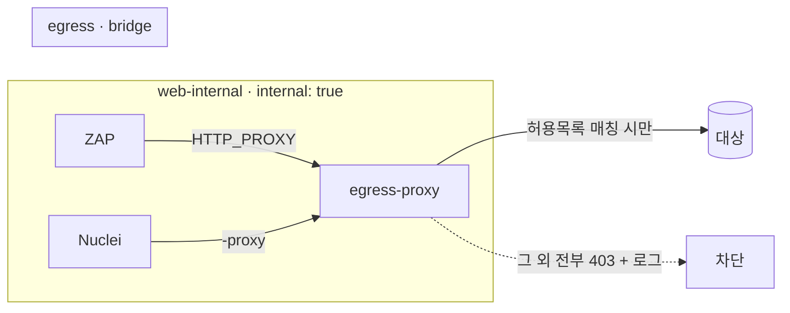

# 네트워크 격리

상위: [[보안 툴킷]] · 결정: [[ADR-004 네트워크 격리 강제]]

## 3단계 네트워크 모델

| 등급 | 구현 | 사용 도구 | 외부 통신 |
|---|---|---|---|
| **N0 완전 차단** | `docker run --network none` | [[Semgrep]], [[Gitleaks]], [[OSV-Scanner]] | 불가 |
| **N1 내부 전용** | compose 네트워크 `internal: true`, 호스트 포트 없음 | [[MobSF]] + mobsf-client | 불가 (컨테이너 간만) |
| **N2 허용목록 이그레스** | `internal: true` 네트워크 + 이중 연결된 `egress-proxy` | [[OWASP ZAP]], [[Nuclei]] | 허용목록 대상만 |
| (예외) 업데이트 | 기본 bridge | `update.sh` | 가능 — 사용자 직접 실행 |

## N2 구조

- 프록시: tinyproxy 또는 squid 경량 이미지 (결정 → [[미결정 사항]])
- 허용목록은 `$CONF/targets.allowlist`에서 생성. 스크립트 검사와 **같은 파일**을 쓰되 독립적으로 강제
- 스캐너가 프록시 설정을 무시하고 직접 나가려 해도 `internal` 네트워크라 불가능
- 프록시 접근 로그 → 차단 요청 목록을 summary에 포함 (예상 밖 통신 탐지)

## 호스트 로컬 서버 점검
로컬 개발 서버(`localhost:3000`)는 컨테이너에서 `host.docker.internal:3000`으로 접근. 이 호스트명을 허용목록에 **포트까지** 명시해야만 허용.

## 확인 방법
→ [[검증 계획#V1 네트워크 차단]]
