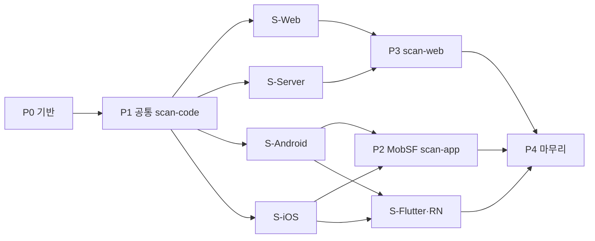

# 구현 계획

상위: [[보안 툴킷]] · 스택 설계: [[스택 프로파일 개요]], [[ADR-008 스택별 프로파일]]

> [!note]
> 보안 플러그인은 `plugins/security/`에 구현한다. **각 단계를 `/workflow:pipeline --no-issue`로 PR 하나씩** 진행하고, 리뷰·반영 후 병합한다. README의 security 섹션도 각 PR에서 함께 갱신한다. 경로 별칭: [[아키텍처#경로 표기]]

## 순서 한눈에

## P0 기반 (안전한 골격)
- [x] `plugins/security/.claude-plugin/plugin.json`, `marketplace.json`에 등록
- [x] 디렉터리 생성 → [[아키텍처#디렉터리 레이아웃 (구현 목표)]]
- [x] `scripts/lib/common.sh`: `$DATA`·`$CONF` 생성(권한 700/600), run-id, 경로 검증(realpath, 금지 경로), 로그
- [x] `preflight`: Docker 런타임 사전 점검 D1~D6, 실패 시 안내 후 종료 → [[Docker 런타임#사전 점검 (스캔 스크립트 공통, P0)]]
- [x] `scripts/lib/detect.sh`: 프로파일 감지 (`detect`·`exclude_paths`, 하위 경로 적용) → [[스택 프로파일 개요#감지 규칙]]
- [x] `profiles/*.yaml` 스키마와 로더, `examples/settings.permissions.json`
- [x] `docker/images.lock`, `rules.lock` 형식 정의
- [x] **README**: security 플러그인 소개, 설치, **Docker 런타임 준비**, 권한 설정 안내
- **완료 조건** ✅: [[검증 계획#V3 안전장치]] 중 **P0 범위**(홈·자격증명·시스템 경로 거부, Docker 꺼짐 D2·이미지 없음 D6, 리포트가 `$DATA/reports/`에만 생성) + 감지 단위 테스트(스택별 샘플 트리) 통과. 허용목록·active scan 인자·리포트 인젝션·대상 git status 무변화는 해당 기능 단계(P1·P3)에서 검증

> [!check] P0 구현 메모
> - 테스트 게이트: `$PLUGIN/tests/run.sh`(bash 단위·통합 + Python unittest), `$PLUGIN/tests/lint.sh`(shellcheck)
> - 설계 대비 변경: Android 감지는 Gradle 플러그인 id 조건, Flutter 감지는 `flutter` 의존성 조건, 감지 형식 3 `{glob, root_markers}`·제외 경로 추가, iOS 감지에서 `macos/` 제외 → [[스택 프로파일 개요#감지 규칙]]
> - 경로 검증은 `realpath`(macOS 13+ `/bin/realpath`, 실제 대소문자로 정규화) + 대소문자·NFC 무시 비교의 이중 장치. 자격증명 폴더는 심볼릭 링크를 푼 실제 위치까지 양방향으로 막는다 (PR #18 리뷰 C1·W1)
> - 사전 점검 D4는 `docker version`의 서버 구성요소(`Engine` 존재, `Podman` 부재)로, D5는 `docker info`의 `MemTotal`(설정값의 90% 이상)로 판별

## P1 공통 /security:scan-code
- [x] `update.sh` 1차: Gitleaks·Semgrep·OSV 이미지 pull(digest 검증), Semgrep 규칙(`generic` + 프로파일 언어), OSV DB
- [x] `scan-code.sh` (N0 네트워크) — 감지된 프로파일의 `semgrep`·`sca` 설정을 합쳐 실행
- [x] `normalize.py` + [[리포트 포맷]] (`profile` 필드)
- [x] `skills/scan-code/SKILL.md`
- [x] 공통 픽스처(시크릿, 취약 lockfile) + 기준선
- **완료 조건** ✅: [[검증 계획]] V1(N0), V2(시크릿·SCA) 통과 — `tests/test_scan_code.sh`의 실제 Docker 통합 테스트

> [!check] P1 구현 메모
> - 고정 버전: semgrep 1.182.0, gitleaks v8.30.1, osv-scanner v2.7.0 (`images.lock`), semgrep-rules `16b9e6d` (`rules.lock`) — 모두 공개 후 7일 이상
> - 사전 점검 **D7 추가**: 컨테이너에서 대상 폴더가 비어 보이면 중단 (Colima 기본 공유 범위 밖 경로가 "0건"으로 조용히 끝나는 문제) → [[Docker 런타임#사전 점검 (스캔 스크립트 공통, P0)]]
> - OSV 오프라인 DB는 스캔한 lockfile의 생태계만 받으므로 `docker/osv-seed/`에 생태계별 씨앗 lockfile을 둔다. CocoaPods(`Podfile.lock`)는 osv-scanner v2.7.0이 추출하지 않는다
> - semgrep-rules에 dart 규칙셋이 없어 `flutter.yaml`의 `rulesets`를 비웠다 (S-Flutter·RN 커스텀 규칙으로 보완) → [[Flutter·React Native]]
> - V2 기준선 `tests/baseline/common.json`: Gitleaks 2(히스토리·미커밋), Semgrep 3, OSV 2. 리포트에 시크릿 원문이 없는지, 픽스처의 인젝션 문구가 summary 코드 블록 안에만 있는지도 함께 검사

## 스택별 PR (P1 이후, 서로 독립)
각 PR은 `profiles/<stack>.yaml` + `rules/custom/<stack>/` + 스택 고유 커스텀 검사 + `tests/fixtures/<stack>/` + 기준선 + README 해당 행을 포함한다.

| PR | 설계 | 핵심 | 완료 조건 |
|---|---|---|---|
| **S-Web** | [[Web]] | W1~W8, Next.js 설정 검사 | 픽스처 W1~W7 탐지 |
| **S-Server** | [[Server]] | S1~S7, Dockerfile·compose 검사 | 픽스처 S1~S7 탐지 |
| **S-Android** | [[Android]] | A1~A8, Manifest·network_security_config·Gradle 검사 | 픽스처 A1~A8 탐지 |
| **S-iOS** | [[iOS]] | I1~I7, Info.plist ATS 검사 | 픽스처 I1~I7 탐지 |
| **S-Flutter·RN** | [[Flutter·React Native]] | F1~F6, R1~R5, 네이티브 하위 경로 적용 | 하위 `ios/`·`android/`에만 네이티브 규칙 적용 확인 |

## P2 /security:scan-app (MobSF) — S-Android·S-iOS 이후
- [ ] `docker/compose.yml`: mobsf, mobsf-client, `scan-internal` 네트워크
- [ ] MobSF 외부 조회 설정 비활성 확인 → [[MobSF#외부 통신 (기본값에서 발생 가능)]]
- [ ] `scan-app.sh`, `skills/scan-app/SKILL.md` — 산출물 유형(APK·AAB·IPA)으로 프로파일 체크리스트 선택
- [ ] 소스 점검(A2·A4·I2)과 MobSF 결과 병합 규칙
- [ ] RN 번들(R6)·Flutter 문자열(F2) 확인
- **완료 조건**: V1(N1, 호스트 노출), V2(모바일) 통과

## P3 /security:scan-web — S-Web·S-Server 이후
- [ ] `egress-proxy` + 허용목록 생성기 (`$CONF/targets.allowlist`)
- [ ] ZAP 서비스 (`web-internal`), `scan-web.sh`, `skills/scan-web/SKILL.md`
- [ ] 프로파일별 확인 항목 (Next.js 소스맵, API 에러 스택트레이스)
- **완료 조건**: V1(N2), V3(허용목록) 통과

## P4 마무리
- [ ] 실측: LuLu로 전체 스캔 통신 기록
- [ ] 베이스라인 비교(신규/해결 표시)
- [ ] `cleanup.sh` (30일 보관)
- [ ] (선택) [[Nuclei]] 추가
- [ ] **README**: 업데이트 방법, 문제 해결
